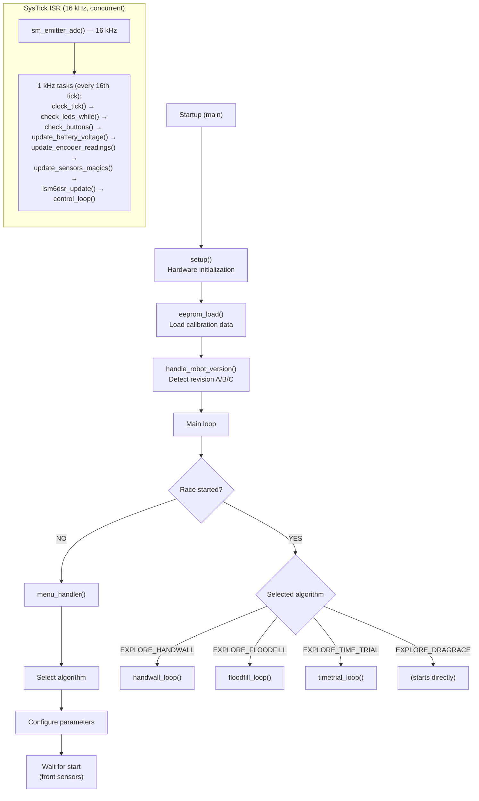

# ZoroBot3 Technical Documentation

> High-performance Micromouse robot powered by an STM32F4, with high-resolution magnetic encoders, a suction fan, and four infrared sensors.
>
> **Document version**: 2026-08-25
> **Branch**: `develop`

---

## 🏆 Competition Results

| 🥇 | 🥈 | 🥉 |
|:--:|:--:|:--:|
| **8** | **0** | **0** |

Competitions won: OSHWDem 2023–2025, RoboChallenge 2024–2025, and Portuguese Contest 2025–2026.

---

## 📚 Documentation Index

Each section links to a separate, detailed document.

### 1. Hardware
- **[Hardware](01-hardware.md)** — Robot specifications: MCU, sensors, motors, encoders, gyroscope, battery, chassis, PCB, and robot revisions (A/B/C).

### 2. Software Architecture
- **[Software Architecture](02-software-architecture.md)** — Main loop, SysTick ISR, 1 kHz task scheduling, race flow, race-start detection, and exploration algorithms.

### 3. Sensors
- **[Sensor System](03-sensors.md)** — IR hardware (SFH-4550 + ST-1KL3A), ADC state machine, distance linearization, hysteresis-based wall detection, calibration, and PID control error calculations.

### 4. Movement
- **[Movement System](04-movement.md)** — 26 movement types, sinusoidal turn profiles, multi-cell straight runs, speed-run orchestration, and wall-loss correction.

### 5. Floodfill
- **[Floodfill Algorithm](05-floodfill.md)** — BASIC, DIAGONAL, and TIME_BASED modes; kinematic weight calculation; BFS with a priority queue; path following; exploration; and speed runs.

### 6. PID Control
- **[PID Control System](06-control-system.md)** — Seven cascaded PID loops, PID formula, anti-windup, battery compensation, acceleration ramps, and saturation detection.

### 7. Menu and Execution Algorithms
- **[Menu System](07-menu-system.md)** — Button-based menu navigation, exploration algorithm selection (HandWall, FloodFill, TimeTrial, DragRace), speed configuration, and debug options.

### 8. Debugging
- **[Debug System](08-debug-system.md)** — Information LEDs, RGB LED, USART serial port, debug functions, and raw-value capture.

### 9. Calibration
- **[Calibration](09-calibration.md)** — Front, front-center, and side sensor calibration; gyroscope calibration; and EEPROM persistence.

### 10. Scripts: IR Sensor Calibration
- **[Sensor Calibration Scripts](10-scripts-sensors.md)** — Offline Jupyter tool for calibrating IR sensors, generating linearization profiles, magics, and C structs for the firmware.

### 11. EEPROM
- **[EEPROM Management](11-eeprom.md)** — Storage layout, checksum (two's complement), calibration loading/saving, persistent maze storage, and memory usage.

### 12. Encoders and Gyroscope
- **[Encoders and Gyroscope](12-encoders-gyro.md)** — AS5145B-HSST (12-bit), timer-based quadrature reading, `max_likelihood_counter_diff`, LSM6DSR (SPI, 1000–4000 dps), low-pass filtering, and angular integration.

### 13. Battery and LEDs
- **[Battery and LEDs](13-battery-leds.md)** — Voltage monitoring, voltage divider, status LEDs, RGB LED, and fan control.

### 14. Simulator
- **[MMSIM Simulator](14-simulator.md)** — Micromouse Simulator integration, virtual-wall API, and time estimation.

### 15. Kinematics and Speed Strategies
- **[Kinematics](15-kinematics.md)** — Speed strategies (EXPLORE through HAKI), acceleration profiles, turn parameters, and speed degradation.

### 16. Scripts: Turn Profiles
- **[Turn Profile Scripts](16-scripts-turn-profiles.md)** — Offline Jupyter system for generating sinusoidal angular-acceleration turn profiles, with per-turn input and output parameters.

### 17. Known Issues
- **[Known Issues Register](17-known-issues.md)** — 64 documented issues (10 critical, 24 moderate, 30 minor), including IDs, descriptions, impact, and solutions.

---

## 🔧 Technology Stack

| Component | Details |
|-----------|---------|
| **MCU** | STM32F405RGT6 @ 168 MHz (ARM Cortex-M4F) |
| **Framework** | LibOpenCM3 + PlatformIO |
| **Language** | C11 |
| **Compiler** | GCC ARM Embedded (arm-none-eabi-gcc) |
| **IDE** | VSCode |
| **Version control** | Git (branch `develop`) |

---

## 📐 Maze Dimensions

| Parameter | Value |
|-----------|-------|
| Cell dimension | 180 mm |
| Cell diagonal | 127.3 mm |
| Wall width | 12 mm |
| Center-to-wall distance | 84 mm |
| Maximum size | 16×16 cells |
| Current size | 6×6 cells |

---

## 🏗️ Project Structure

```text
ZoroBot3/
├── docs/                    # 📚 Documentation (this directory)
├── source_code/
│   ├── include/             # Headers (.h)
│   │   ├── config.h         # General configuration and build flags
│   │   ├── constants.h      # Physical and system constants
│   │   ├── sensors.h        # IR sensor API
│   │   ├── move.h           # Movement and kinematics API
│   │   ├── floodfill.h      # Navigation API
│   │   ├── control.h        # PID control API
│   │   ├── menu.h           # Menu API
│   │   ├── calibrations.h   # Calibration API
│   │   ├── eeprom.h         # EEPROM API
│   │   ├── encoders.h       # Encoder API
│   │   ├── lsm6dsr.h        # Gyroscope API
│   │   ├── leds.h           # LED API
│   │   ├── battery.h        # Battery API
│   │   ├── motors.h         # Motor API
│   │   ├── utils.h          # Logarithm lookup table
│   │   ├── handwall.h       # Wall-following algorithm
│   │   ├── timetrial.h      # Time-trial algorithm
│   │   ├── dragrace.h       # Drag-race algorithm
│   │   ├── debug.h          # Debug functions
│   │   ├── buttons.h        # Button reading
│   │   ├── usart.h          # Serial port
│   │   ├── setup.h          # Hardware initialization
│   │   ├── clock.h          # System timer
│   │   └── delay.h          # Delays
│   └── src/                 # Implementations (.c)
│       └── (corresponding implementation files)
├── pcb_files/               # PCB design (KiCad)
├── scripts/                 # Calibration and analysis scripts (Jupyter)
├── images/                  # Robot images
└── README.md                # Main project README
```

---

## ⚡ System Frequencies

| Component | Frequency | Details |
|-----------|-----------|---------|
| SYSCLK | 168 MHz | System clock |
| SysTick ISR | 16 kHz | Base interrupt |
| sm_emitter_adc() | 16 kHz | ADC state machine |
| clock_tick() | 1 kHz | System timer |
| update_sensors_magics() | 1 kHz | Sensor processing |
| update_encoder_readings() | 1 kHz | Encoder reading |
| lsm6dsr_update() | 1 kHz | Gyroscope reading |
| control_loop() | 1 kHz | PID control loop |
| update_battery_voltage() | 1 kHz | Battery reading |
| check_buttons() | 1 kHz | Button reading |
| check_leds_while() | 1 kHz | LED updates |
| Motor PWM | 20 kHz | Switching frequency |

---

## 🔄 High-Level Flow



---

## 📝 Notes

- Source-code references use paths relative to the project root (e.g. [`source_code/src/sensors.c`](../source_code/src/sensors.c)).
- Issue IDs (FF-XX, SS-XX, MV-XX, HW-XX, SW-XX, SP-XX) correspond to the [known issues register](17-known-issues.md).

---

*Document generated on 2026-08-25 for the ZoroBot3 `develop` version.*
